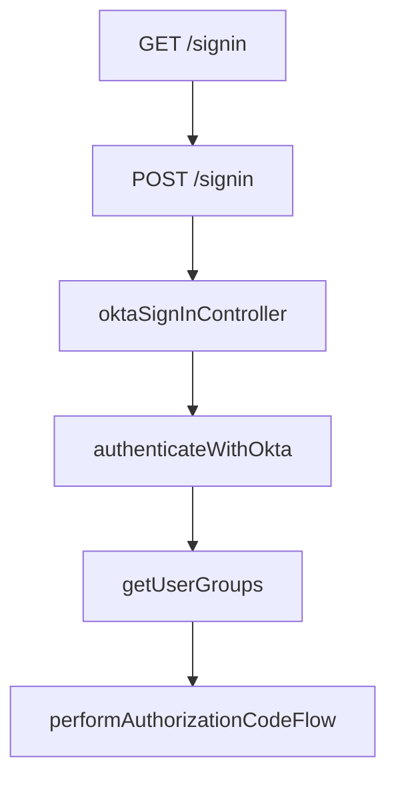
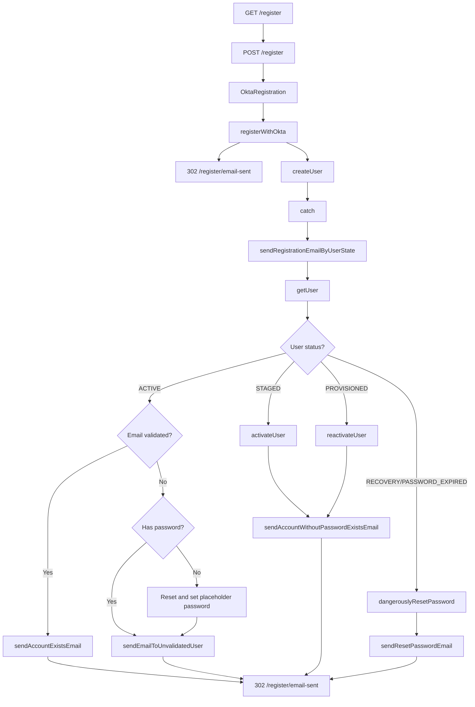
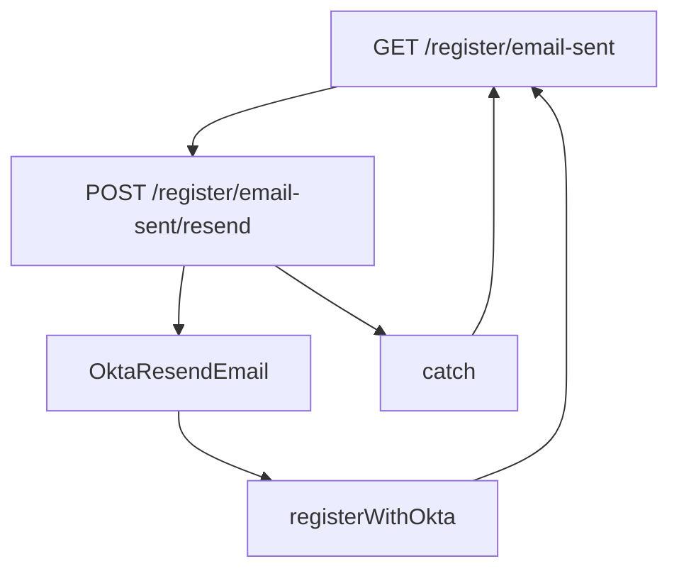
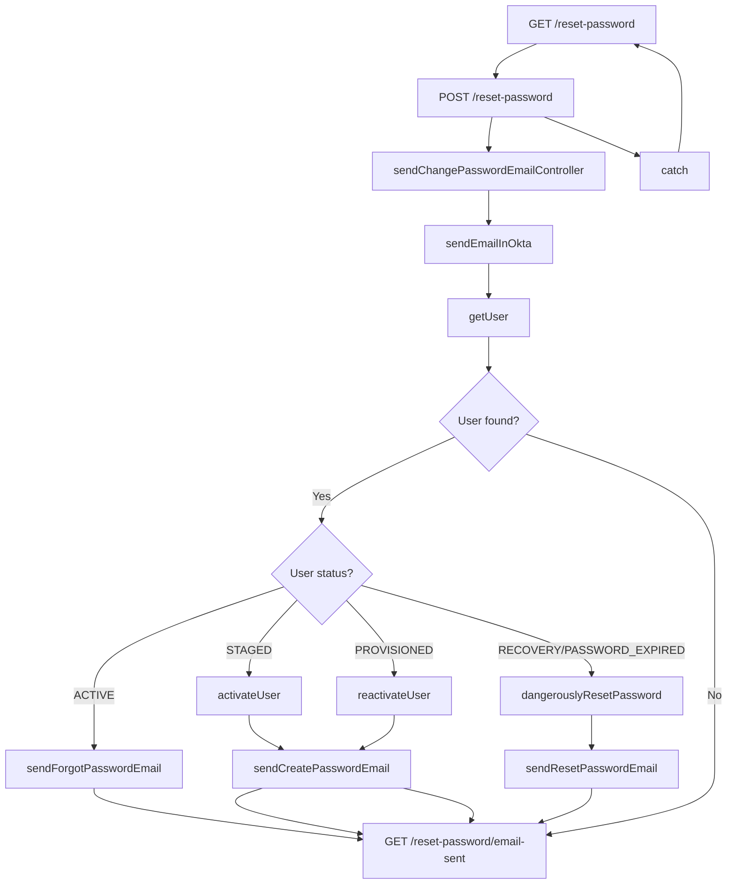

# Flow diagrams for common Gateway routes

**_Note: These diagrams are outdated and describe behaviour for the older Okta Classic API. For more up to date flows using the newer Okta IDX API, see the [IDX Documentation](./okta/idx/README.md)_**

## Sign in

_Note: See [IDX Sign In](./okta/idx/sign-in-idx.md) for the most up to date flow_

## Register / Create Account

_Note: See [IDX Create Account](./okta/idx/create-account-idx.md) for the most up to date flow for new users_

### Resend registration email

## Reset password

_Note: See [IDX Reset Password](./okta/idx/reset-password-idx.md) for the most up to date flow_

## Newsletter unsubscribe

`GET /unsubscribe/newsletter/:data/:token` displays a review page.
`POST` to the same path forwards the unsubscribe request to IDAPI and renders
a success or error page.
The browser POST requires CSRF credentials.

`POST /list-unsubscribe/newsletter/:data/:token` is the dedicated email-client
endpoint. It returns an empty 204 on success, 400 for client errors, or 500 for server
failures. It doesn't render HTML or redirect and GET requests do not unsubscribe.
The `data` parameter contains `newsletterId:userId:timestamp` (timestamp is an integar)

The list-unsubscribe POST is excluded from CSRF validation so email providers
can call it without browser cookies or a CSRF form field. Authorization depends
on IDAPI validating the subscription token against the user ID, newsletter ID,
and timestamp in `data`.
